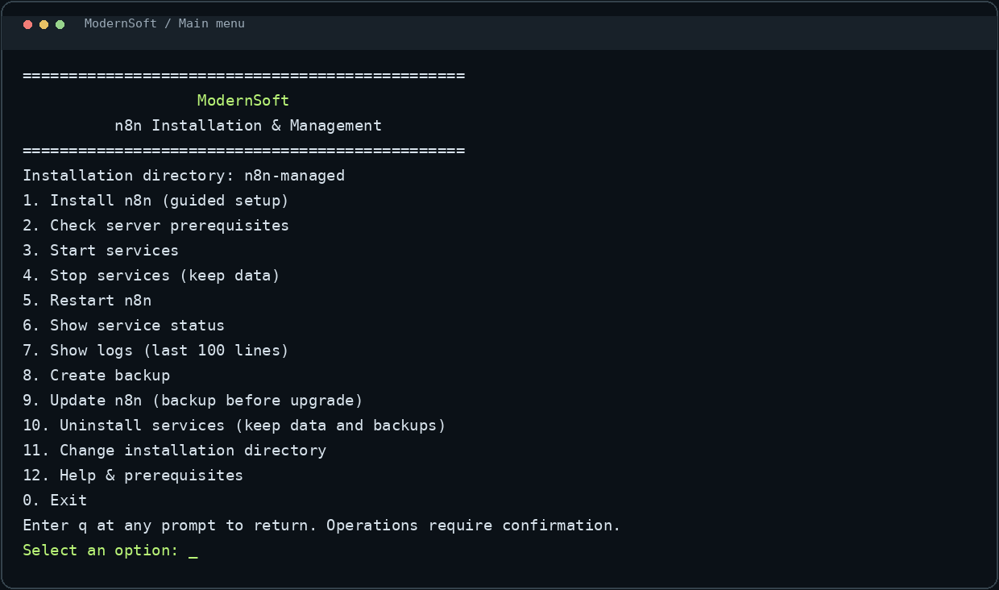
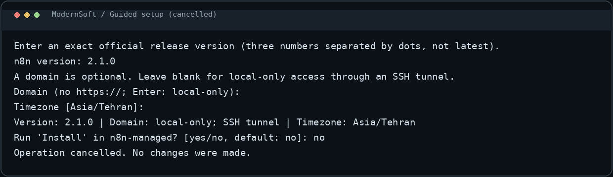
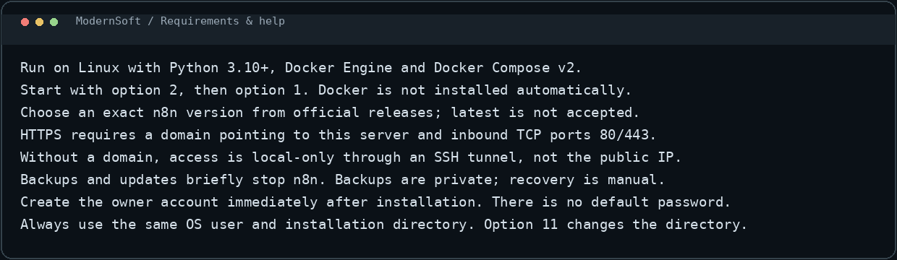

# ModernSoft n8n Manager

[**English**](README.md) | [**فارسی**](README.fa.md)

<div dir="rtl">

**گردش‌کارهای شما، زیرساخت خودتان.**

ModernSoft ابزاری منومحور برای نصب و مدیریت n8n روی سرور لینوکسی است. این پروژه n8n را همراه با PostgreSQL اجرا می‌کند و قابلیت HTTPS اختیاری، پشتیبان‌گیری خصوصی و به‌روزرسانی به نسخهٔ مشخص را فراهم می‌کند.

**[صفحهٔ معرفی دوزبانه و پیش‌نمایش](index.html)** · **[مجوز MIT](LICENSE)** · **[راهنمای امنیت](SECURITY.md)**

در صفحهٔ معرفی با دکمهٔ «فارسی / English» زبان را عوض کنید. انتخاب زبان در همان مرورگر ذخیره می‌شود. دکمه‌های بالای این README بین دو سند فارسی و انگلیسی جابه‌جا می‌شوند؛ گیت‌هاب کد تغییر زبان صفحهٔ HTML را داخل README اجرا نمی‌کند.

> این پروژه ابزار مدیریت استقرار است؛ خود n8n یا یک پنل مدیریت تحت وب جدید نیست. صفحهٔ معرفی و تصاویر آن، اجرای زندهٔ سرویس را نشان نمی‌دهند. رابط خط فرمان برنامه همچنان انگلیسی است. تست‌های موجود، نصب واقعی روی سرور، صدور گواهی یا بازیابی موفق اطلاعات را تضمین نمی‌کنند.

## امکانات

| قابلیت | رفتار |
| --- | --- |
| نصب مرحله‌ای | دریافت نسخه، دامنه و منطقهٔ زمانی با اعتبارسنجی و تأیید کاربر |
| دیتابیس PostgreSQL | فضای ذخیره‌سازی پایدار و بدون انتشار پورت دیتابیس |
| HTTPS اختیاری | تنظیم Caddy برای دامنهٔ متصل به سرور |
| حالت محلی | اتصال n8n فقط به آدرس لوپ‌بک و دسترسی از طریق تونل SSH |
| تنظیمات خصوصی | تولید رمز دیتابیس و کلید رمزگذاری تصادفی، با دسترسی محدود فایل‌ها |
| پشتیبان‌گیری | بکاپ دیتابیس، فایل‌های برنامه و تنظیمات نصب |
| به‌روزرسانی کنترل‌شده | انتخاب نسخهٔ دقیق n8n، بکاپ پیش از ارتقا و بررسی سلامت سرویس |
| حذف با حفظ داده | حذف کانتینرها و شبکه، بدون حذف داده‌ها، تنظیمات و بکاپ‌ها |
| ابزارهای عملیاتی | روشن و خاموش‌کردن، راه‌اندازی مجدد، وضعیت، گزارش و بررسی پیش‌نیازها |

## تصاویر محیط برنامه

تصاویر زیر از خروجی واقعی ترمینال ساخته شده‌اند؛ تصویر یک سرور مستقرشده یا محیط داخلی ویرایش گردش‌کار n8n نیستند. نمونهٔ نصب پیش از اجرا لغو شده است و شمارهٔ نسخهٔ داخل آن، صرفاً نمونهٔ ورود اطلاعات است.

### منوی اصلی

[](assets/menu.png)

### راهنمای نصب

[](assets/setup.png)

### راهنما و پیش‌نیازها

[](assets/help.png)

## پیش‌نیازها

- سرور لینوکسی با Python نسخهٔ 3.10 یا جدیدتر و داده‌های منطقهٔ زمانی IANA.
- Docker Engine و افزونهٔ Docker Compose v2 با پشتیبانی از انتظار برای سلامت سرویس.
- حساب سیستم مورداعتماد با مجوز استفاده از Docker؛ این دسترسی بسیار قدرتمند است.
- فضای دیسک و منابع کافی و دسترسی به مخازن ایمیج‌ها.
- برای HTTPS عمومی: دامنهٔ متصل به سرور و بازبودن پورت‌های ورودی TCP 80 و 443.

این ابزار Docker را نصب نمی‌کند، DNS و فایروال را تغییر نمی‌دهد و آپدیت زمان‌بندی‌شده ایجاد نمی‌کند.

## شروع سریع

۱. مخزن را با دکمهٔ Code در گیت‌هاب دانلود یا کلون کنید و وارد پوشهٔ پروژه شوید.

۲. فایل‌های `n8n.sh` و `n8n_manager.py` باید کنار هم باشند. منو را اجرا کنید:

</div>

```bash
bash n8n.sh
```

<div dir="rtl">

۳. گزینهٔ **۲** را برای بررسی پیش‌نیازها و سپس گزینهٔ **۱** را برای نصب انتخاب کنید.

۴. نسخهٔ دقیق را از [انتشارهای رسمی n8n](https://github.com/n8n-io/n8n/releases) انتخاب کنید. دامنه اختیاری و منطقهٔ زمانی پیش‌فرض `Asia/Tehran` است. مثال‌های نسخه در برنامه، پیشنهاد نسخهٔ فعلی نیستند.

۵. خلاصهٔ تنظیمات را بررسی و با `yes` تأیید کنید. Enter در مرحلهٔ تأیید یعنی لغو؛ `q` شما را به منو برمی‌گرداند.

۶. بلافاصله پس از نصب، حساب مالک n8n را بسازید. نام کاربری یا رمز پیش‌فرضی تنظیم نمی‌شود.

### پوشهٔ نصب

پیش‌فرض، پوشهٔ `n8n-managed` داخل مسیر کاری فعلی است. همیشه از همان حساب سیستم و همان پوشه استفاده کنید. برای مسیر مشخص:

</div>

```bash
bash n8n.sh --directory /srv/modernsoft-n8n
```

<div dir="rtl">

گزینهٔ ۱۱ فقط پوشهٔ انتخاب‌شده در نشست فعلی منو را عوض می‌کند؛ اطلاعات نصب را جابه‌جا نمی‌کند. در اجراهای بعدی همان مسیر را دوباره مشخص کنید.

### دسترسی بدون دامنه

در حالت محلی، پورت n8n روی IP عمومی باز نمی‌شود. روی کامپیوتر خود تونل بسازید:

</div>

```bash
ssh -L 5678:127.0.0.1:5678 USER@SERVER
```

<div dir="rtl">

نام کاربر و آدرس سرور خود را جایگزین کنید و از پورت محلی 5678 وارد شوید. وبهوک‌های عمومی به استقرار عمومی قابل‌دسترسی نیاز دارند. برای HTTPS، تنظیم DNS، شبکه و صدور گواهی باید روی سرور بررسی شود.

## گزینه‌های منو

| شماره | عملکرد |
| --- | --- |
| ۱ | نصب مرحله‌ای |
| ۲ | بررسی پیش‌نیازها |
| ۳ | روشن‌کردن سرویس‌ها |
| ۴ | خاموش‌کردن با حفظ اطلاعات |
| ۵ | راه‌اندازی مجدد n8n |
| ۶ | نمایش وضعیت |
| ۷ | نمایش ۱۰۰ خط آخر گزارش |
| ۸ | تهیهٔ بکاپ |
| ۹ | ارتقای n8n با بکاپ اولیه |
| ۱۰ | حذف سرویس با حفظ اطلاعات |
| ۱۱ | تغییر پوشهٔ انتخاب‌شده |
| ۱۲ | راهنما |
| ۰ | خروج |

دستورهای مستقیم هم موجودند؛ آن‌ها برخلاف منو لزوماً تأیید تعاملی نمی‌گیرند:

</div>

```bash
bash n8n.sh --help
bash n8n.sh status
bash n8n.sh backup
bash n8n.sh uninstall --confirm
```

<div dir="rtl">

## بکاپ، آپدیت و بازیابی

بکاپ در زیرپوشهٔ `backups/` مسیر نصب ذخیره می‌شود و شامل خروجی PostgreSQL، فایل‌های برنامه، تنظیمات و کلید رمزگذاری است. در صورت موفقیت در تولید محتوای بکاپ، فایل `COMPLETE` نوشته می‌شود؛ این علامت تضمین بازیابی یا سلامت سرویس پس از راه‌اندازی نیست.

**بکاپ‌ها رمزگذاری نمی‌شوند و محرمانه‌اند.** آن‌ها را عمومی نکنید؛ نسخهٔ امن خارج از سرور نگه دارید و فضای دیسک را کنترل کنید. پاک‌سازی خودکار بکاپ‌های قدیمی وجود ندارد. بکاپ و آپدیت باعث توقف موقت n8n می‌شوند.

آپدیت به نسخهٔ دقیق و جدیدتر انجام می‌شود. پیش از آن یادداشت‌های مهاجرت نسخه را بخوانید. مهاجرت دیتابیس ممکن است برگشت‌پذیر نباشد؛ دانگرید مسدود است و **بازیابی یا بازگشت خودکار وجود ندارد**. بازیابی دستی به دیتابیس، فایل‌ها و کلید رمزگذاری سازگار نیاز دارد. داده‌های گواهی Caddy در بکاپ نیستند و ممکن است صدور مجدد لازم شود.

فقط نسخهٔ n8n به‌صورت دقیق انتخاب می‌شود؛ ایمیج‌های PostgreSQL و Caddy از تگ نسخهٔ اصلی استفاده می‌کنند. پیش از استفادهٔ عملیاتی، بازیابی را روی محیطی جداگانه آزمایش کنید.

حذف سرویس، کانتینرها و شبکه را حذف می‌کند؛ داده‌ها، تنظیمات و بکاپ‌ها باقی می‌مانند. گزینهٔ Start سرویس‌ها را با داده‌های باقی‌مانده دوباره ایجاد می‌کند. حذف سرویس به معنی پاک‌سازی کامل اطلاعات نیست.

## آزمون‌ها و مشارکت

</div>

```bash
python3 -m unittest -v test_n8n_manager
bash -n n8n.sh
```

<div dir="rtl">

آزمون‌ها رفتار برنامه را با شبیه‌سازی عملیات Docker بررسی می‌کنند؛ آزمون استقرار واقعی یا ممیزی امنیتی نیستند. [راهنمای مشارکت](CONTRIBUTING.md) و [راهنمای امنیت](SECURITY.md) جزئیات بیشتری دارند.

## مجوز و ذکر منبع

این ابزار با [مجوز MIT](LICENSE) و اعلان حق‌نشر **2026 ModernSoft** منتشر شده است. فورک، استفاده، تغییر و بازنشر، حتی تجاری، با حفظ متن مجوز و اعلان حق‌نشر مجاز است. اعتبار پیشنهادی:

</div>

> Based on ModernSoft n8n Manager. Copyright (c) 2026 ModernSoft. Licensed under the MIT License.

<div dir="rtl">

ذکر اعتبار در توضیحات جایگزین نگهداری فایل LICENSE نیست. این مجوز مربوط به ابزار مدیریت است؛ n8n، Docker، PostgreSQL و Caddy مجوزها و نشان‌های تجاری خود را دارند. این پروژه محصول رسمی n8n نیست.

</div>
